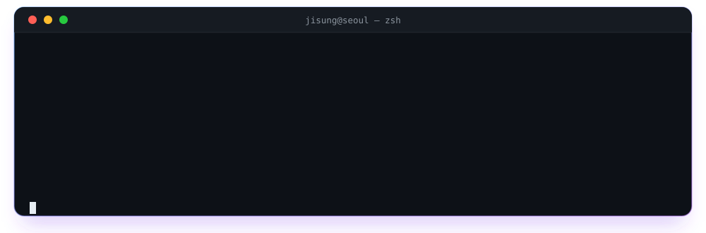
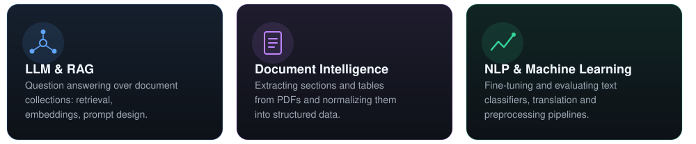

  
  

<h2 align="center">What I build</h2>

<h2 align="center">Tech stack</h2>

<h2 align="center">Currently</h2>

Building AI products on LLMs and document pipelines 
Learning large-scale data processing 
Open to collaboration on AI and machine learning projects 
Looking for input on deep learning optimization techniques

