  
  

## About

AI developer in Seoul, working mainly in Python. I design and build systems around large language models: retrieval-augmented generation, document understanding, and the data pipelines that feed them. 3+ years across machine learning, data processing and backend services.

## Focus

<table>
<tr>
<td width="33%" valign="top">

**LLM &amp; RAG** 
Question-answering over document collections with retrieval, embeddings and prompt design.

</td>
<td width="33%" valign="top">

**Document intelligence** 
Extracting sections and tables from PDFs and normalizing them into structured data.

</td>
<td width="33%" valign="top">

**NLP &amp; ML** 
Fine-tuning and evaluating text classifiers, translation and preprocessing pipelines.

</td>
</tr>
</table>

## Stack

<table>
<tr><td><b>Languages & ML</b></td><td>     </td></tr>
<tr><td><b>Data</b></td><td>     </td></tr>
<tr><td><b>Infra & Tools</b></td><td>   </td></tr>
</table>

## Currently

- Building AI products on LLMs and document pipelines
- Learning large-scale data processing
- Open to collaboration on AI and machine learning projects
- Looking for input on deep learning optimization techniques
